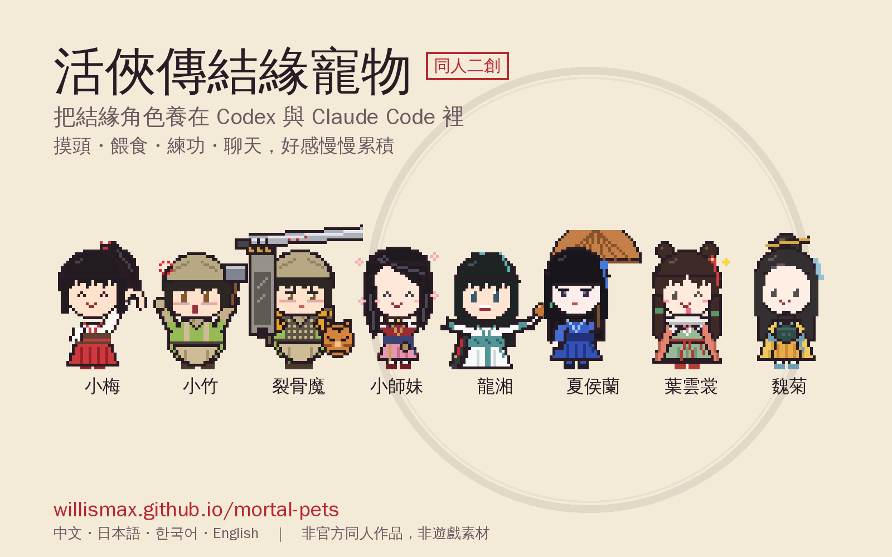

# 活俠傳結緣寵物（同人）

**中文** ｜ [日本語](README.ja.md) ｜ [한국어](README.ko.md) ｜ [English](README.en.md)




把《活俠傳》的結緣角色做成 **Codex 寵物**和 **Claude Code 寵物**，並依角色個性寫了互動對話。目前有小梅（虞小梅）、小竹（郁竹）、小師妹（唐默鈴）、龍湘、夏侯蘭、葉雲裳、魏菊七位。

- 線上試玩：<https://willismax.github.io/mortal-pets/>（直接開 `index.html` 也可以；右上角可切換中文、日本語、한국어、English，分享時可加 `?lang=ja`、`?lang=ko`、`?lang=en`）
- Claude Code 安裝：`/plugin install mortal-buddy --marketplace willismax/mortal-pets`
- 非官方二創：角色設定整理自公開資料；像素圖、台詞都是原創，沒有使用遊戲素材或原文。

## 目錄

```
mortal-pets/
├── .claude-plugin/marketplace.json  Claude Code 外掛市集設定
├── index.html                    互動網頁：摸頭、餵食、練功、送禮、聊天、9 種動畫預覽
├── install.sh                    安裝 Codex 寵物／skill／通知，以及 Claude Code status line
├── codex/pets/<id>/              Codex 寵物：xiaomei、xiaozhu、xiaozhu-battle、xiaoshimei、longxiang、xiahoulan、yeyunshang、weiju
├── codex/qa/                     總覽圖與各狀態 GIF，方便檢查動畫
├── claude-plugin/mortal-buddy/   Claude Code 外掛
│   ├── hooks/hooks.json          依工作狀態切換心情與台詞
│   ├── commands/                 /mortal-buddy:pick、pet、talk、roleplay、status、mute
│   ├── skills/xiaomei|xiaozhu/   角色卡（Codex 也能用）
│   └── scripts/
│       ├── buddy.cjs             hook、status line、互動指令、Codex 通知共用的程式
│       ├── characters.js         角色資料與台詞（網頁、Claude、Codex 共用）
│       └── locales/              日文、韓文、英文台詞（ja.js、ko.js、en.js）
├── promo/                        宣傳圖、招牌動作 GIF 與巴哈／Threads 貼文草稿
└── tools/
    ├── build_sprites.py          產生像素 spritesheet
    ├── make_promo.py             產生 promo/ 的宣傳圖與 GIF
    └── check_locales.cjs         檢查日韓英語言檔的結構
```

## Codex 寵物

```bash
git clone https://github.com/willismax/mortal-pets.git
cd mortal-pets && ./install.sh codex
```

會把八隻寵物（小梅、小竹、小竹・裂骨魔、小師妹、龍湘、夏侯蘭、葉雲裳、魏菊）複製到 `~/.codex/pets/`，角色卡複製到 `~/.codex/skills/`。接著到 Codex 的 Settings → Pets → Refresh 選一隻；對話中可用 `/pet` 叫出或收起寵物。

想在每輪完成時收到角色的系統通知，在 `~/.codex/config.toml` 加上（安裝腳本會印出實際路徑）：

```toml
notify = ["node", "/home/你/.mortal-buddy/bin/buddy.cjs", "codex-notify"]
```

spritesheet 照 Codex 的固定格式：8 欄 × 9 列、每格 192×208、未使用的格子全透明。每列的動作如下：

| 列 | 狀態 | 小梅 | 小竹 |
| --- | --- | --- | --- |
| 0 | idle | 雙手背在身後，眨眼、馬尾輕晃 | 半垂著眼睏睏地發呆 |
| 1–2 | running-right / left | 輕功小跑，馬尾往後甩 | 小碎步 |
| 3 | waving | **鶴手**：抬手、手腕下彎、指尖朝下 | 害羞揮手、臉紅 |
| 4 | jumping | **招牌飛踢**：蹲、躍起、側踢、落地冒愛心 | 一手握拳、一手高舉大鐵鎚大喊 💢 |
| 5 | failed | **眨眼吐舌、握拳敲頭**冒星星（裝傻） | 錘子掉了、淚眼汪汪 |
| 6 | waiting | 雙手背後、臉紅冒汗地斜眼看你 | 捧著木頭青蛙問你要不要 |
| 7 | running（工作中） | 攪鍋煮菜、冒熱氣 | 掄錘打鐵、火星四濺，最後**用手套擦汗**大笑 |
| 8 | review | 閉眼「哼」一聲，再瞇眼打量、指間閃過銀針 | 湊近瞇眼看齒輪 |

小師妹、龍湘、夏侯蘭：

| 列 | 狀態 | 小師妹 | 龍湘 | 夏侯蘭 |
| --- | --- | --- | --- | --- |
| 0 | idle | **雙手交握**在胸前，安靜地眨眼 | 站著啃雞腿 | **撐著油紙傘**、兩眼無神 |
| 1–2 | running-right / left | 輕快小跑 | 大步跑 | 冷著臉走 |
| 3 | waving | 雙手握著鬢髮、開心得身邊冒小花 | 舉著雞腿大力揮手 | 撐著傘伸手示意「懶徒兒，跟我來」 |
| 4 | jumping | 輕功一躍、張開雙臂 | 以雞腿為劍，躍起直刺 | 難得的驚訝，**用袖子遮臉**臉紅 |
| 5 | failed | 迷路了：左看右看，然後縮著手**「抖抖抖」** | 錢包又被偷了：摸腰、大哭 | 不悅地嘆氣、袖子遮臉 |
| 6 | waiting | 抬頭靜靜看著你 | 摸肚子、流口水 | 撐傘斜眼、不耐煩 |
| 7 | running（工作中） | 摺紙鶴 | 認真練劍 | 收起傘，示範奪魄門掌法 |
| 8 | review | 捧著紙鶴端詳 | 歪頭冒問號 | **不屑**：撐傘斜眼冷笑 |

造型依官方立繪：小師妹是往後梳的黑髮（側分、斜瀏海，一部分鬢髮垂在胸前）、頸上掛鈴、暗紅短袖上衣配白荷葉袖口、深藍腰帶束出細腰、順順垂下的粉紅長裙；龍湘是半束髮髻插青簪、額間紅花鈿、白衣青領青腰帶與護腕、手持長劍；夏侯蘭是齊瀏海長黑髮、藍色髮繩與翠綠耳墜、藍色寬袖長衣、油紙傘。

修改造型後重新產生：

```bash
python3 tools/build_sprites.py --preview   # 需要 Pillow；--preview 會更新 codex/qa/
```

## Claude Code 寵物

Claude Code 內建的 `/buddy` 物種是依帳號固定的，無法自訂，所以這裡做成外掛：

```text
/plugin install mortal-buddy --marketplace willismax/mortal-pets
```

（舊版 Claude Code 請分兩步：`/plugin marketplace add willismax/mortal-pets`，再 `/plugin install mortal-buddy@mortal-pets`。）

裝好後她會跟著你的工作狀態反應：

| 事件 | 心情 | 例子 |
| --- | --- | --- |
| 開新對話 | 打招呼 | 小竹(¬_¬)「……（瞇眼）誰？喔，是你啊。靠近一點，我看不清楚。」 |
| 送出問題 | 審視 | 小梅(￢‿￢)「讓我瞧瞧……嗯，這裡藏了一根針呢。」 |
| 執行工具 | 工作中 | 小竹(ง'̀-'́)ง「叮、叮、噹——別吵，火候正好。」 |
| 指令失敗 | 失敗 | 小梅(；ω；)「哎呀，炸鍋了？沒事，失敗的菜我也能改成佳餚。」 |
| 等你允許 | 等待 | 小梅(・∀・)?「欸，等你點頭呢。別讓姑娘家等太久喔。」 |
| 完成一輪 | 完成（好感 +1） | 小竹(•̀ᴗ•́)و「打好了。……不是兇你，我只是沒睡。」 |

互動指令：

| 指令 | 說明 |
| --- | --- |
| `/mortal-buddy:pick xiaozhu` | 換寵物（`xiaomei`、`xiaozhu`、`xiaoshimei`、`longxiang`、`xiahoulan`、`yeyunshang`、`weiju`） |
| `/mortal-buddy:pet feed` | `pet` 摸頭、`feed` 餵食、`train` 練功（各 +1）、`gift` 送禮（+3），同一種互動一分鐘內只算一次 |
| `/mortal-buddy:talk` | 她出題，用 `/mortal-buddy:talk 2` 回答，答案會加減好感 |
| `/mortal-buddy:roleplay 今天好累` | 載入角色卡，讓她用自己的口吻回你 |
| `/mortal-buddy:status` | 查看兩人的好感與階段 |
| `/mortal-buddy:mute` | 開關對話中的反應訊息 |
| `/mortal-buddy:lang ja` | 切換語言：`zh` 中文、`ja` 日本語、`ko` 한국어、`en` English（第一次會依系統語系自動判斷） |

好感分四個階段：初識（0）、熟識（10）、知己（30）、結緣（60）。到了「知己」，深夜（23:00–05:00）她偶爾會說出藏在心底的話。

想讓她一直待在畫面下方，執行 `./install.sh statusline`，依指示把 status line 加進 `~/.claude/settings.json`：

```text
小梅(๑˃ᴗ˂)ﻭ「你寫你的，我在旁邊揉麵團，誰也不吵誰～」  ♥♥♡♡♡ 知己 31
```

狀態存在 `~/.mortal-buddy/state.json`，Claude Code 與 Codex 通知共用同一份好感。

## 素材整理

### 小梅（虞小梅）

- 崆峒派飛天門當代嫡傳女弟子，「崆峒四姝」之一（虞小梅、夏侯蘭、郁竹、魏菊）。四門嫡傳女弟子中聲望最高，第一掌派夫人的位子幾乎被認定是她的。
- 紅白衣裙，「恰似雪裡梅花」。天真爛漫、活潑愛笑、擅長交朋友。
- 有時會用「本梅」自稱，只有這時候說的話才是真心話。
- 廚藝高超：能把趙活失敗的菜改成佳餚，做的茶點菓子很受鄉親歡迎。
- 結緣線可利用留學期間的跑步、練功事件推進。
- 劇透：真實身分是千燈樓培養的刺客（新任千面人魔候補），殺人技巧由千燈樓「五炷香」金烏上人調教。官方日文角色介紹也寫她「似乎有隱藏的另一面」。

設計對應（參考官方立繪）：高馬尾綁紅髮繩、白上衣紅交領、深褐腰封、紅色長褶裙、褐色護腕；招牌動作保留飛踢、鶴手、眨眼吐舌敲頭、雙手背後；工作時煮菜；審視時閉眼「哼」一聲、指間一根銀針（千燈樓伏筆）；平常用「我」，真心話才用「本梅」。

### 小竹（郁竹）

- 崆峒派鐵拳門掌門的嫡傳女弟子，「崆峒四姝」之一，江湖人稱「裂骨魔」。
- 專司冶煉鐵器，從小鑽研機關巧術，有靈感就廢寢忘食。接手大鐵鋪鑄農具、打兵器，她的兵器在崆峒要排隊好幾年。
- 身形嬌小卻力大無窮。眼神兇是因為睡眠不足加上近視，其實性情純良。
- 個性誠實，所以撒嬌時殺傷力特別高；喜歡做玩具。
- 結緣線重點在留學期間跑鐵拳巷；會請趙活陪她返鄉「演一場戲」。

設計對應（參考官方立繪）：打鐵後用手套擦汗的招牌動作；卡其頭巾與領巾、淺綠短袖上衣、長工作手套、卡其長圍裙、腦後一小撮頭髮、臉頰常帶紅暈、眼皮半垂的琥珀色睏眼；工作時打鐵；等待時捧著自己做的木頭青蛙；審視時湊近看齒輪；說話直、短、常停頓。

另有戰鬥造型 **小竹・裂骨魔**（`codex/pets/xiaozhu-battle/`）：鐵網護甲；右手（畫面左邊）的前臂是一整塊機關板，頂端三隻爪子抓著刻紅紋的巨劍高舉過頭；左手（畫面右邊）拿虎頭盾。兩者在背後靠虎紋肩甲與背包相連，胸前沒有背帶。開心時巨劍舉更高，失敗時劍尖垂下。日常版開心時會像官方圖那樣一手握拳、一手高舉大鐵鎚大喊。兩種造型的小竹都是圓滾滾的身材（圓身體、粗手腳、圓臉頰）。網頁上可以切換兩種造型。

### 小師妹（唐默鈴）

- 唐門掌門的獨生女，本作第一位女主角。母親早逝，幾乎是由趙活一手照顧長大。
- 氣質宛如森林小動物，生性淡漠、不常表露感情；平素無事之時喜歡摺紙。
- 身繫七串鈴鐺，卻從來聽不見響聲（練了「天地無聲勢」）。
- 輕功據說可排天下前五，卻常常認不得路；怕冷；對「吃飽」沒什麼概念。
- 趙活每晚在她窗下說故事、唱山歌（小師妹之歌）哄她睡，她一直都知道。
- 劇透：掌門曾把她許配給大師兄，大師兄死後三師兄又決定讓她遠嫁。

設計對應（參考官方角色設定圖與立繪）：往後梳的黑髮、側分斜瀏海、鬢髮垂在胸前、淡淡腮紅、頸上與袖上的鈴鐺、暗紅上衣配細腰與順順垂下的粉紅長裙；招牌的雙手交握，開心時握著鬢髮、身邊冒小花；工作時摺紙鶴；開心時輕功一躍；失敗時縮著手「抖抖抖」；說話短、常用「……」。

### 龍湘

- 師承錦香宮、劍法精絕的清麗佳人，人稱「雞腿女俠」。踏著父親的足跡，嚮往承其父志、行俠四方。高挑窈窕、英姿颯爽。
- 坦率開朗、有點呆：收了劍就呆頭呆腦，烤雞不拔毛、錢包總被割，容易上當。
- 家傳劍法從小以雞腿為劍練起，最愛餐餐有雞腿；對感情遲鈍，常以武會友。

設計對應（參考 LoM Wiki 立繪）：半束髮髻插青簪、額間紅花鈿、白衣青領青腰帶與護腕、深色劍鞘配紅劍穗，手上總有雞腿；開心時拿雞腿當劍直刺；失敗是錢包又被偷；等待時摸肚子流口水。

### 夏侯蘭

- 崆峒派奪魄門掌門的嫡傳女弟子，「崆峒四姝」之一，江湖人稱「奪魄幽蘭」。
- 容姿淒艷、武藝一流，曾是最有望成為第一掌派夫人的女弟子；如今是行事狠辣乖戾的女魔頭，幽居在不見天日的奪魄森林中，生人勿近。
- 平時一臉生無可戀、兩眼無神；對趙活嘴上尖酸刻薄，修練與照顧卻無微不至。她的路線裡才看得到驚訝、害羞的表情。
- 劇透：本名夏侯梅，原為雪山派掌門之女；曾嫁給同門，卻遭夫婿背叛。

設計對應（參考 LoM Wiki 立繪）：齊瀏海長黑髮、藍色髮繩、藍色寬袖長衣、撐著油紙傘、無神的眼睛；揮手是「懶徒兒，跟我來」；開心是難得的驚訝、用袖子遮臉；審視是不屑；台詞嘴硬心軟。

### 葉雲裳

- 點蒼派弟子，人稱「點蒼明珠」，葉雲舟的胞妹。
- 縱是盛夏，貂裘亦不離身；俏皮愛搗蛋的美貌姑娘，卻總鬧不消半天便會發燒倒下。
- 愛惡作劇、愛撒嬌又任性，鬧過頭弄哭人又會後悔；愛吃甜食；看似天真，其實對外人相當戒備。
- 劇透：葉家世代效忠岳家軍，遭朝廷清算後父母冤死；她幼時被一掌震斷經脈，靠點蒼高人保住性命，內傷至今未癒。

設計對應（參考 LoM Wiki 立繪與表情）：深棕中分瀏海、頭頂雙小髻配紅花與紅緞帶、胸前低雙馬尾（綠繩）、珊瑚色斗篷配白毛領、豆綠長裙與紅細腰帶。

| 列 | 狀態 | 葉雲裳 |
| --- | --- | --- |
| 0 | idle | 雙手捏著胸前的領結 |
| 3 | waving | **欸嘿**：眨眼吐舌冒星星 |
| 4 | jumping | **興奮**：抓著斗篷往兩邊張開跳起來 |
| 5 | failed | **嘟嘴**生悶氣 → **大哭** → **發燒**沒力氣 |
| 6 | waiting | **祈禱**：雙手合十拜託你 |
| 7 | running（工作中） | 拿著樹枝（聽雲棒）氣呼呼地比劃 |
| 8 | review | **有心事**：垂著眼安靜下來，最後害羞一笑 |

### 魏菊

- 崆峒派玄功門當代的嫡傳女弟子，兼任當代掌門，「崆峒四姝」之一。
- 儀態端莊，知書達禮，文靜而秀麗脫俗，與崆峒派格格不入的奇女子。
- 溫和、不愛動武，卻很受派內敬重；早年是金陵有名的才女。愛讀書、愛品茶。
- 手裡捧的手爐，是郁竹打造的機巧之物。
- 劇透：好感夠高時，離開崆峒會以心聲揭露她隱藏的身分。

設計對應（參考 LoM Wiki 立繪與表情）：長髮往後梳、頭頂盤髻插金簪、側邊淺藍髮帶、黃色寬袖外袍、白內衣淺藍交領、橙黃長裙配藍腰帶，雙手捧著深綠手爐。

| 列 | 狀態 | 魏菊 |
| --- | --- | --- |
| 0 | idle | 捧著手爐溫柔微笑，手爐冒著熱氣 |
| 3 | waving | 微微欠身，害羞得**頭頂冒熱氣** |
| 4 | jumping | **閉眼臉紅地笑**，端莊地輕輕一跳 |
| 5 | failed | **嚇到摀嘴尖叫**發抖，再努力恢復端莊 |
| 6 | waiting | **驚訝冒汗**地看著你 |
| 7 | running（工作中） | 捧著書安靜地讀、翻頁 |
| 8 | review | 臉上一片**陰影**，意味深長地微笑 |

### 新增角色

步驟：

1. 在 `tools/build_sprites.py` 的 `CHARACTERS` 加配色與特徵，在 `poses_for()` 設計各狀態動作。
2. 在 `scripts/characters.js` 加角色資料、各心情台詞與聊天題目。
3. 在 `skills/` 加角色卡，然後執行 `python3 tools/build_sprites.py --preview`。
4. 改了角色資料或圖之後，把 `index.html` 裡所有 `?v=` 版本號加一，瀏覽器才不會拿快取的舊檔配新網頁（會整頁空白）。

### 參考來源

- [活俠傳日本語制作会：虞小梅角色介紹（X）](https://x.com/Mortal_jp/status/1971907682823995814)
- [聯合新聞網：虞小梅、郁竹感情線將同步推出](https://game.udn.com/game/story/122089/9203339)
- [聯合新聞網：原先無法與崆峒四姝全數結緣？](https://game.udn.com/game/story/122089/8097264)
- [聯合新聞網：虞小梅「屍心蠱」關鍵文本](https://game.udn.com/game/story/122089/9831528)
- [酷時尚：〈崆峒神威〉更新開放虞小梅、郁竹結緣線](https://www.cool-style.com.tw/wd2/archives/1352050)
- [4Gamers：崆峒神威 DLC 攻略](https://www.4gamers.com.tw/news/detail/82729/legend-of-mortal-kongtong-shenwei-dlc-guide)
- [LoM Wiki：虞小梅](https://smilin.net/LoM-wiki/people/characters/girl3.html)、[郁竹](https://smilin.net/LoM-wiki/people/characters/girl6.html)
- [Reko Wiki：活俠傳登場人物一覽](https://rekowiki.org/wiki/%E6%B4%BB%E4%BF%A0%E5%82%B3/%E7%99%BB%E5%A0%B4%E4%BA%BA%E7%89%A9%E4%B8%80%E8%A6%BD-Part1)
- [巴哈姆特：為什麼小梅又瘋又色？](https://forum.gamer.com.tw/C.php?bsn=73317&snA=4436)、[梅竹線心得](https://forum.gamer.com.tw/C.php?bsn=73317&snA=4443)、[小竹路線討論串](https://forum.gamer.com.tw/C.php?bsn=73317&snA=4304)
- [TWGameX：虞小梅線完整解析](https://twgamex.com/games/%e6%b4%bb%e4%bf%a0%e5%82%b3/888/)
- [活俠傳日本語制作会：夏侯蘭角色介紹（X）](https://x.com/Mortal_jp/status/1971182910456959476)、[趙活角色介紹](https://x.com/Mortal_jp/status/1974444394955878833)
- [LoM Wiki：唐默鈴](https://smilin.net/LoM-wiki/people/characters/girl0.html)、[夏侯蘭](https://smilin.net/LoM-wiki/people/characters/girl5.html)、[龍湘](https://smilin.net/LoM-wiki/people/characters/girl8.html)
- [巴哈姆特：龍湘線含相關資訊統整](https://forum.gamer.com.tw/C.php?bsn=73317&snA=536)
- [聯合新聞網：夏侯蘭支線更新](https://game.udn.com/game/story/122089/9823786)
- [4Gamers：活俠傳女角人氣投票](https://www.4gamers.com.tw/news/detail/66059/legend-of-mortal-female-characters-popularity-charts)
- [聯合新聞網：葉雲裳結緣攻略](https://game.udn.com/game/story/122090/8970592)、[LoM Wiki：葉雲裳](https://smilin.net/LoM-wiki/people/characters/girl2.html)、[GAMEX JP：葉雲裳ルート解説](https://gamexjp.com/games/1538/)
- [LoM Wiki：魏菊](https://smilin.net/LoM-wiki/people/characters/girl7.html)、[巴哈姆特：魏菊系列劇情影片](https://forum.gamer.com.tw/C.php?bsn=73317&snA=1670)、[遊戲狂：魏菊隱藏劇情攻略](https://gamemad.com/guide/336609)
- Codex 寵物格式：[openai/skills hatch-pet](https://github.com/openai/skills/tree/main/skills/.curated/hatch-pet)（`references/animation-rows.md`）

## 版權

《活俠傳》（Legend of Mortal）及其角色的著作權屬於原開發商與發行商。本資料夾是非官方同人作品，程式碼依 repo 的 MIT 授權釋出。
